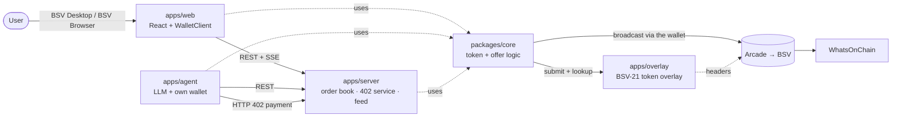
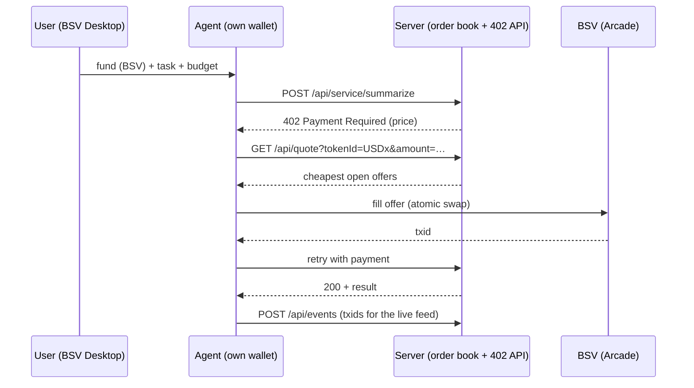

# Architecture

Draft written before the event. P1–P4 refine it while they build.

## Components



## Custody: who signs what

| Money path                     | Signed by                                                           | Custody shape                                 |
| ------------------------------ | ------------------------------------------------------------------- | --------------------------------------------- |
| A maker lists tokens           | The maker's BRC-100 wallet (`createSignature`)                      | A: the user's wallet                          |
| A person fills an offer        | The taker's BRC-100 wallet (`createAction`)                         | A                                             |
| The user funds the agent       | The user's wallet pays the agent's identity key                     | A                                             |
| The agent swaps and pays       | The agent's own wallet (wallet-toolbox), capped by its spend policy | B: the agent's operator (the user running it) |
| The service takes 402 payments | The service's server wallet                                         | B                                             |

The order book never holds keys or funds: it relays signed offers and reports fills. Shapes A and B follow the
BSV AI toolkit's [custody shapes](https://github.com/bsv-blockchain/bsv-ai-toolkit/blob/main/content/custody-shapes.md).

## BSV-21 overlay

Bitcoin Script does not enforce BSV-21: a "transfer" minted from plain satoshis broadcasts fine. A token UTXO is
genuine only if every input back to the deploy was, and an overlay checks that. We run the developer pack's overlay
(`starter/bsv21-token-kit/overlay`) ourselves as `apps/overlay` (P1), so we need no public BSV-21 indexer on testnet.

- One Node process and one SQLite file; topic `tm_tokenkit`, lookup service `ls_tokenkit`.
- Testnet: `NETWORK=test`, with SPV block headers from Arcade's testnet chaintracks
  (`https://arcade-v2-testnet-us-1.bsvblockchain.tech/chaintracks/v2`). The kit itself uses Arcade only on mainnet and
  the rate-limited WhatsOnChain API on testnet. After the USDx deploy, `TOKEN_WHITELIST` holds the USDx token id.
- Core submits every token transaction to the overlay, parents first, right after the wallet call. The wallet basket
  is only a local copy: core spends only UTXOs the overlay admitted and has not seen spent, with the overlay's BEEF as
  `inputBEEF`.
- Web, server and agent all reach it through core, the browser included, so the demo environment must expose it like
  the server. If `data/overlay.db` is lost, the transactions can be re-submitted from chain in order.

## Broadcasting

Core does not broadcast by itself. It calls `createAction` / `signAction` with `acceptDelayedBroadcast: false`, so the
caller's wallet broadcasts before it returns; core then submits the transaction to the overlay and returns its
WhatsOnChain link (`wocTxUrl`).

- BSV Desktop broadcasts through Arcade first (developer pack guide §20.4).
- Server and agent wallets (wallet-toolbox) use `Setup`'s default providers unless they are built with their own
  `Services` and `options.arcadeUrl` set to the testnet Arcade host (guide §14.2 shows it for mainnet).

## Atomic offer

```
input 0    maker's token UTXO       ← maker signs with SIGHASH_SINGLE | ANYONECANPAY | FORKID (0xC3)
output 0   priceSats → maker        ← covered by the maker's signature
input 1+   taker's funding          ← added and signed by the taker's wallet
output 1   token transfer → taker   (swap-and-pay: → the service instead)
output 2+  change
version 1, lockTime 0, input 0 sequence 0xffffffff   ← also covered, so the taker keeps them
```

The maker's signature commits only to input 0 and output 0. The taker can add funding and the token output, but
cannot change the price or the payee. To cancel, the maker spends the token UTXO.

- **One offer, one token UTXO.** An offer sells a whole UTXO. If the maker holds more, `createOffer` first splits off
  a UTXO of exactly `tokenAmount` (one extra transaction), so a fill moves the whole amount and has no token change.
- **Signing.** Core computes the BIP-143 preimage and the maker's wallet signs only its hash: `createSignature` with
  `hashToDirectlySign` and the token key (protocol `[1, 'bsv21 token']`, the UTXO's keyID, counterparty `'anyone'`).
  The kit signs its transfers the same way in BSV Desktop, so the wallet needs no support for the sighash type.
- **The maker's payment key.** Output 0 pays a BRC-29 key whose keyID comes from the offer's outpoint, with the
  maker's own identity key as counterparty: the maker derives it for itself before any taker exists, so `Offer` needs
  no extra field. After a fill, `claimOfferPayment` takes output 0 into the maker's wallet as a `wallet payment`, so it
  counts towards the maker's balance.

Checked against the developer pack's token kit and the installed `@bsv/wallet-toolbox` 2.14.9:

- BSV-21 transfers: the overlay sums token inputs and outputs per token id, so the token input may sit at index 0 and
  moving the whole amount is admitted.
- `createAction` puts the caller's inputs first and, with `options.randomizeOutputs: false`, the caller's outputs in
  their order, then change. Its defaults are version 1, lockTime 0 and sequence 0xffffffff; `fillOffer` still passes
  them explicitly.
- BSV Desktop and `createSignature`: see Signing. Still to try once in BSV Desktop on testnet.

## Agent swap-and-pay

The MVP prices the service in sats; pricing it in USDx (below) is the stretch goal.



## API (draft)

This table is the old AgentSwap draft. The FlashCrowd API is in [apps/server/README.md](../apps/server/README.md#api).

| Method | Path                               | Purpose                                                         |
| ------ | ---------------------------------- | --------------------------------------------------------------- |
| GET    | `/health`                          | Liveness and network                                            |
| GET    | `/api/offers?tokenId=&status=open` | List offers                                                     |
| POST   | `/api/offers`                      | Submit a signed offer (validated before listing)                |
| POST   | `/api/offers/:id/filled`           | Report a fill txid (the server checks it spends the offer UTXO) |
| DELETE | `/api/offers/:id`                  | Withdraw an offer whose UTXO the maker has spent                |
| GET    | `/api/quote?tokenId=&amount=`      | Cheapest offers that cover an amount                            |
| GET    | `/api/feed`                        | Server-sent events: offers, fills, payments, agent steps        |
| POST   | `/api/events`                      | The agent posts its steps to the feed                           |
| POST   | `/api/service/summarize`           | Paid AI endpoint behind HTTP 402                                |

Shared types: [`packages/core/src/types.ts`](../packages/core/src/types.ts). Core functions and who calls them:
[`packages/core/README.md`](../packages/core/README.md#api).
