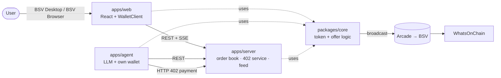
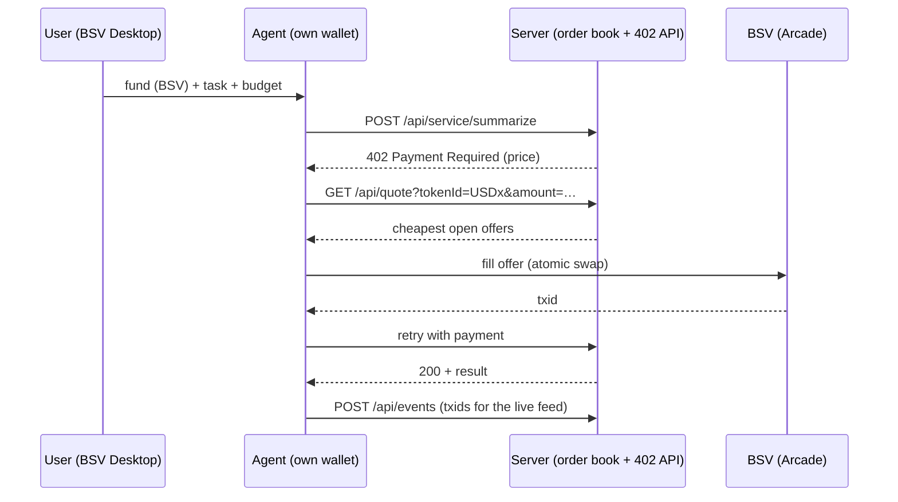

# Architecture

Draft written before the event. P1–P4 refine it while they build.

## Components



## Custody: who signs what

| Money path                     | Signed by                                                       | Custody shape                         |
| ------------------------------ | --------------------------------------------------------------- | ------------------------------------- |
| A maker lists tokens           | The maker's BRC-100 wallet (`createSignature`)                  | A: the user's wallet                  |
| A person fills an offer        | The taker's BRC-100 wallet (`createAction`)                     | A                                     |
| The user funds the agent       | The user's wallet pays the agent's identity key                 | A                                     |
| The agent swaps and pays       | The agent's own wallet (wallet-toolbox), capped by its spend policy | B: the agent's operator (the user running it) |
| The service takes 402 payments | The service's server wallet                                     | B                                     |

The order book never holds keys or funds: it relays signed offers and reports fills. Shapes A and B follow the
BSV AI toolkit's [custody shapes](https://github.com/bsv-blockchain/bsv-ai-toolkit/blob/main/content/custody-shapes.md).

## Atomic offer

```
input 0    maker's token UTXO       ← maker signs with SIGHASH_SINGLE | ANYONECANPAY | FORKID
output 0   priceSats → maker        ← covered by the maker's signature
input 1+   taker's funding          ← added and signed by the taker's wallet
output 1   token transfer → taker   (swap-and-pay: → the service instead)
output 2+  change
```

The maker's signature commits only to input 0 and output 0. The taker can add funding and the token output, but
cannot change the price or the payee. To cancel, the maker spends the token UTXO.

P1 checks these against the developer pack before building:

- BSV-21 transfer rules when the token input sits at index 0 and the whole amount moves.
- `createAction` keeps the caller's inputs first; outputs need `options.randomizeOutputs: false`.
- How BSV Desktop handles `createSignature` for the maker's protocol-derived key.

## Agent swap-and-pay

The MVP prices the service in sats; pricing it in USDx (below) is the stretch goal.



## API (draft)

| Method | Path                               | Purpose                                                        |
| ------ | ---------------------------------- | -------------------------------------------------------------- |
| GET    | `/health`                          | Liveness and network                                           |
| GET    | `/api/offers?tokenId=&status=open` | List offers                                                    |
| POST   | `/api/offers`                      | Submit a signed offer (validated before listing)               |
| POST   | `/api/offers/:id/filled`           | Report a fill txid (the server checks it spends the offer UTXO) |
| DELETE | `/api/offers/:id`                  | Withdraw an offer whose UTXO the maker has spent               |
| GET    | `/api/quote?tokenId=&amount=`      | Cheapest offers that cover an amount                           |
| GET    | `/api/feed`                        | Server-sent events: offers, fills, payments, agent steps       |
| POST   | `/api/events`                      | The agent posts its steps to the feed                          |
| POST   | `/api/service/summarize`           | Paid AI endpoint behind HTTP 402                               |

Shared types: [`packages/core/src/types.ts`](../packages/core/src/types.ts).
