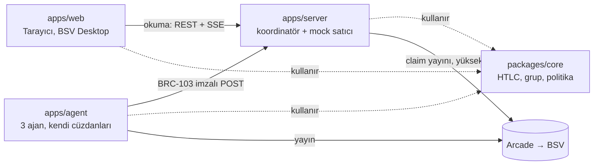
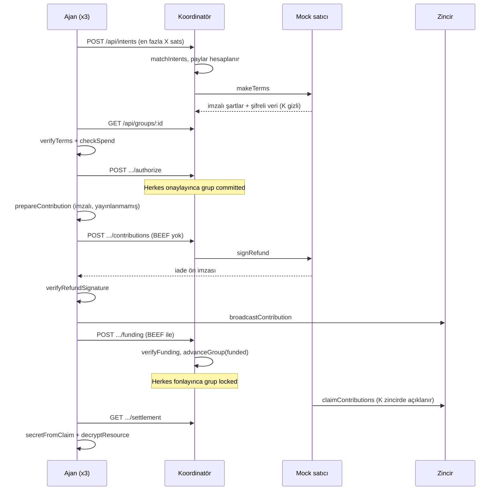
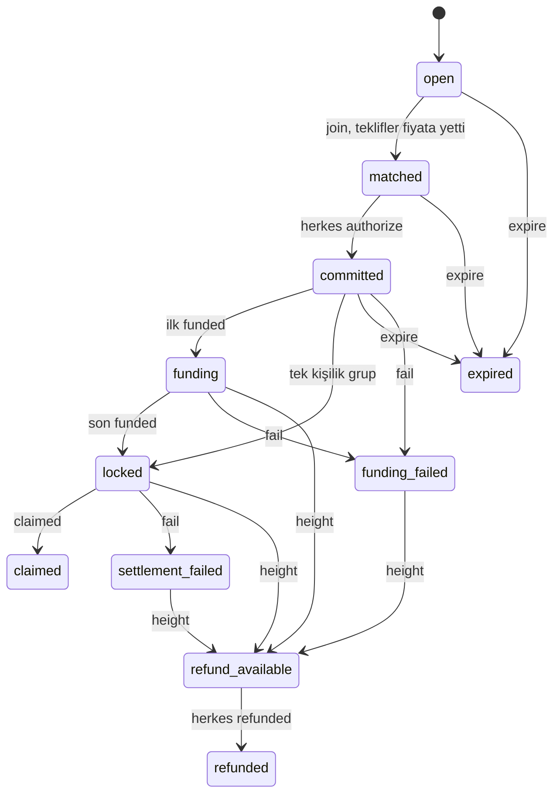

# FlashCrowd geliştirici kılavuzu

Bu kılavuz `main` dalının `9584ca7` commit'indeki kodu dosya dosya anlatır. Her dosyanın ne işe yaradığını ve içindeki her
dışa açık fonksiyonun, sınıfın ve tipin görevini açıklar. Satır satır okuma yerine geçmez: amaç, bir değişiklik yapmadan
önce doğru dosyayı bulmak ve o dosyanın kurallarını bilmektir.

**Gerçek çalıştırmalar ve demolar mainnet'te yapıldı**, yani gerçek para harcar. `.env.example` ise kazara para harcanmasın diye
testnet'le başlar. Kalan işler [bölüm 11](#11-açık-işler)'de.

## İçindekiler

1. [Proje ne yapıyor](#1-proje-ne-yapıyor)
2. [Kavramlar](#2-kavramlar)
3. [Kurulum ve komutlar](#3-kurulum-ve-komutlar)
4. [Kural: `paths` tsconfig.json'a konmaz](#4-kural-paths-tsconfigjsona-konmaz)
5. [Repo haritası](#5-repo-haritası)
6. [packages/core](#6-packagescore)
7. [apps/server](#7-appsserver)
8. [apps/agent](#8-appsagent)
9. [apps/web](#9-appsweb)
10. [Testler ve araçlar](#10-testler-ve-araçlar)
11. [Açık işler](#11-açık-işler)
12. [Değişmez kurallar](#12-değişmez-kurallar)
13. [Sık yapılan işler](#13-sık-yapılan-işler)
14. [Sorun giderme](#14-sorun-giderme)

## 1. Proje ne yapıyor

FlashCrowd'da birkaç AI ajanı, tek başına alamayacağı bir dataseti birlikte satın alır. Her ajan kendi payını kendi HTLC
çıktısına kilitler. Satıcı parayı ancak şifre çözme anahtarını (`K`) zincirde açıklayarak, tek işlemde alabilir. Satıcı
almazsa her ajan belli bir blok yüksekliğinden sonra parasını geri alır.

Kod tek bir Node sürecinde değil, dört parçada çalışır:



Sunucu iki ayrı rol taşır ve bunlar bilerek ayrı anahtar kullanır:

- **Koordinatör:** Niyetleri ve grupları tutar, sıra yönetir. Alıcıların anahtarını ve parasını tutmaz.
- **Mock satıcı:** Kendi cüzdanı olan ayrı bir taraftır. Şartları imzalar, iade imzası verir ve parayı talep eder.

### Mutlu yol



Güvenliğin temeli, ajanın **iade imzasını eline almadan fonlamayı yayınlamamasıdır**. Bu sıra bozulursa ajanın parası
satıcının insafına kalır.

### İade yolu

Satıcı süresinde almazsa grup `refund_available` olur. Her ajan `refundContribution` ile parasını alır ve
`POST .../refunds` ile sunucuya bildirir. Sunucu kapalı olsa bile iade mümkündür, çünkü ajanın elinde gereken her şey vardır.

## 2. Kavramlar

| Terim                 | Anlamı                                                                                                    |
| --------------------- | --------------------------------------------------------------------------------------------------------- |
| UTXO, outpoint        | Harcanmamış çıktı. Kodda `<txid>.<vout>` biçiminde yazılır.                                               |
| sats                  | Satoshi. Kodda her zaman güvenli tam sayıdır, asla float değildir.                                        |
| HTLC                  | Hash'e ve zamana bağlı kilit. Burada: `K` ile satıcı alır, iki imzayla alıcı geri alır.                   |
| `K`, `H`              | `K` 32 baytlık gizli anahtar, `H = sha256(K)`. Bir grubun bütün çıktıları aynı `H`'yi kullanır.           |
| `refundHeight`        | İade işleminin `nLockTime` değeri olan blok yüksekliği.                                                   |
| nLockTime             | İşlem bu yükseklikten önce geçerli sayılmaz. BSV'de `OP_CHECKLOCKTIMEVERIFY` çalışmadığı için kullanılır. |
| Ön imza, sighash 0xC2 | Satıcının iadeyi önceden imzalaması. `NONE \| ANYONECANPAY \| FORKID`: yalnız o girdiye bağlıdır.         |
| BEEF, AtomicBEEF      | İşlemi ve atalarının kanıtlarını taşıyan paket (BRC-62, BRC-95). Kodda hex dizgi olarak gezer.            |
| SPV                   | Tüm zinciri indirmeden, merkle kanıtıyla doğrulama. `tx.verify(chainTracker)`.                            |
| BRC-100               | Standart cüzdan arayüzü (`WalletInterface`): `createAction`, `signAction`, `createSignature`.             |
| BRC-42/43             | Anahtar türetme. `protocolID + keyID + counterparty` üçlüsü bir anahtar belirler.                         |
| BRC-103               | Karşılıklı kimlik doğrulama. Sunucuda `@bsv/auth-express-middleware`, istemcide `AuthFetch`.              |
| identity key          | Cüzdanın kök genel anahtarı. Kimliktir, ödeme almak için kullanılmaz.                                     |
| Arcade                | Yayın ve blok başlıkları servisi. WhatsOnChain (WoC) ise kullanıcıya gösterilen gezgindir.                |
| mock chain            | wallet-toolbox'ın sahte zinciri. Testler bunu kullanır, gerçek ağ davranışını kanıtlamaz.                 |

## 3. Kurulum ve komutlar

Gereksinim: Node 22.9 veya üstü (CI ve `.nvmrc` 22 kullanır).

```bash
npm install
cp .env.example .env
npm run wallet:init -w @agentswap/server    # iki anahtar dosyası; çıktıyı .env'e yapıştır
npm run dev:server                          # http://localhost:8787/health
npm run dev:web                             # http://localhost:5173
```

Mainnet için `.env`'de `BSV_NETWORK=mainnet` yazın. Anahtar yollarını `wallet:init`'in yazdırdığı tam haliyle kopyalayın: sunucu `.env`'deki
`~` işaretini açmaz. Ajanlar başka makinedeyse sunucuyu `cloudflared tunnel --url http://localhost:8787` ile açın ve adresi
onların `SERVER_URL` ayarına yazın. Yeni tünel yeni adres demektir.

| Komut (kök dizinden)                                                    | Ne yapar                                                                                   |
| ----------------------------------------------------------------------- | ------------------------------------------------------------------------------------------ |
| `npm run typecheck`                                                     | Bütün paketlerde tip kontrolü                                                              |
| `npm test`                                                              | Bütün paketlerin testleri                                                                  |
| `npm run build -w @agentswap/web`                                       | Web'in üretim derlemesi (CI bunu da çalıştırır)                                            |
| `npm run format`                                                        | Prettier                                                                                   |
| `npm run wallet:init -w @agentswap/server`                              | Koordinatör ve satıcı anahtarlarını oluşturur                                              |
| `npm run wallet:init -w @agentswap/agent -- <dosya>`                    | Bir ajan anahtarı oluşturur                                                                |
| `npm run wallet -w @agentswap/agent -- address <dosya>`                 | Ajanın kimliği ve para yatırma adresi                                                      |
| `npm run wallet -w @agentswap/agent -- sweep <dosya> <txid>.<vout>`     | Madenciliği bitmiş yatırımı cüzdana alır                                                   |
| `npm run wallet -w @agentswap/agent -- balance <dosya>`                 | Harcanabilir bakiye                                                                        |
| `npm run wallet -w @agentswap/agent -- receive <dosya> <ödeme dosyası>` | Web'in "Ajanı fonla" dosyasını cüzdana alır                                                |
| `npm run wallet -w @agentswap/agent -- refund <dosya>`                  | Yarım kalan koşunun kilitli paylarını defterden iade eder                                  |
| `BSV_NETWORK=mainnet npm run testnet:htlc -w @agentswap/core -- init`   | HTLC'yi sunucusuz zincirde deneyen script ([bölüm 4](#4-kural-paths-tsconfigjsona-konmaz)) |
| `npm run dev:agent -- --agents 3 --check`                               | Ajanlar hazır mı, satın alma yapmaz                                                        |
| `npm run dev:agent -- --agents 3`                                       | Gerçek satın alma                                                                          |

### Ortam değişkenleri

Hepsi kök `.env` dosyasından okunur. `.env` git'e girmez.

| Değişken                      | Varsayılan                 | Kullanan | Anlamı                                                        |
| ----------------------------- | -------------------------- | -------- | ------------------------------------------------------------- |
| `BSV_NETWORK`                 | `testnet`                  | Hepsi    | `mainnet` dışındaki her değer testnet sayılır                 |
| `SERVER_PORT`                 | `8787`                     | Sunucu   | Dinlenen port; web proxy'si de bunu okur                      |
| `SERVER_KEY_FILE`             | zorunlu                    | Sunucu   | Koordinatörün BRC-103 kimliği, para tutmaz                    |
| `SELLER_KEY_FILE`             | zorunlu                    | Sunucu   | Mock satıcının cüzdanı, fon gerekmez                          |
| `SERVER_DATA_DIR`             | `~/.agentswap/server-data` | Sunucu   | Durum dosyası, satıcı sırları, satıcı veritabanı              |
| `SELLER_LOCK_BLOCKS`          | `6`                        | Sunucu   | `refundHeight` = eşleşme yüksekliği + bu; 2'den büyük olmalı  |
| `SELLER_NO_CLAIM`             | `false`                    | Sunucu   | `true` ise satıcı hiç almaz (iade demosu)                     |
| `SERVER_URL`                  | `http://localhost:8787`    | Ajan     | Koordinatörün adresi                                          |
| `AGENT_KEY_DIR`               | `~/.agentswap`             | Ajan     | `agent-1.key` … `agent-N.key` dosyalarının klasörü            |
| `AGENT_KEY_FILES`             | boş                        | Ajan     | Virgülle dosya listesi; verilirse `AGENT_KEY_DIR` kullanılmaz |
| `AGENT_MAX_CONTRIBUTIONS`     | zorunlu                    | Ajan     | Ajan başına en fazla teklif; tek değer hepsine uygulanır      |
| `AGENT_MAX_PER_PURCHASE_SATS` | zorunlu                    | Ajan     | Politika: alım başına üst sınır                               |
| `AGENT_MAX_TOTAL_SATS`        | zorunlu                    | Ajan     | Politika: toplam üst sınır                                    |
| `AGENT_MAX_LOCK_BLOCKS`       | `30`                       | Ajan     | Politika: paranın en uzun kilitli kalacağı blok sayısı        |
| `AGENT_SERVICE_ID`            | `bsv-usd-closes`           | Ajan     | Alınacak servis; satıcıdaki kimlikle aynı olmalı              |
| `AGENT_RESOURCE_ID`           | `bsvusd-2026-10`           | Ajan     | Alınacak veri                                                 |
| `AGENT_ALLOWED_SERVICES`      | `AGENT_SERVICE_ID`         | Ajan     | Politikanın izin verdiği servisler                            |
| `AGENT_POLL_MS`               | `3000`                     | Ajan     | Sunucuyu yoklama aralığı                                      |
| `ANTHROPIC_API_KEY`           | boş                        | Yok      | `.env.example`'da var, `main`'deki kod kullanmıyor            |

Ajan dosyaları anahtarın yanında durur: `agent-N.<ağ>.sqlite` (cüzdan) ve `agent-N.<ağ>.spent.json` (harcama defteri).

Sunucunun ürettiği dosyalar, `SERVER_DATA_DIR` içinde:

| Dosya                      | İçerik                             | Dikkat                                      |
| -------------------------- | ---------------------------------- | ------------------------------------------- |
| `state-<ağ>.json`          | Niyetler, gruplar, claim işlemleri | Herkese açık veridir                        |
| `seller-secrets-<ağ>.json` | Grup başına `K`                    | Gizlidir, mod 600                           |
| `seller-<ağ>.sqlite`       | Satıcının cüzdan veritabanı        | Silinirse satıcı bakiyesi kaybolmuş görünür |

## 4. Kural: `paths` tsconfig.json'a konmaz

`@bsv/sdk`'yı CommonJS derlemesine yönlendiren `paths` ayarı yalnız tip kontrolü içindir ve `tsconfig.check.json`'da durur. `typecheck` betiği de
`tsc -p tsconfig.check.json` çalıştırır. `tsx`, `tsconfig.json`'daki `paths`'i çalışma anında da uygular; ayar oraya konursa uygulama şu hatayla açılmaz:

```text
SyntaxError: The requested module '@bsv/sdk' does not provide an export named 'LockingScript'
```

Vitest kendi `alias` ayarıyla çalıştığı için testler bu hatayı yakalamaz. Yeni bir paket açarken aynı düzeni kullanın ve uygulamayı ayrıca çalıştırıp deneyin.

Çalışma anında uygulama kodu SDK'nın ESM, wallet-toolbox ise CommonJS derlemesini yükler. Toolbox'tan gelen bir SDK nesnesini doğrudan kullanmayın, kendi kopyanızla yeniden kurun (örnek: `sweepDeposits`'teki `MerklePath.fromBinary`).

## 5. Repo haritası

```text
packages/core/          Üç uygulamanın ortak kullandığı zincir mantığı
  src/types.ts            Takımlar arası sözleşme
  src/config.ts           Ağ seçimi, Arcade adresleri, WoC linkleri
  src/htlc.ts             HTLC: script, şartlar, fonlama, claim, iade   ← demo yolu
  src/collective.ts       Grup durum makinesi ve eşleştirme             ← demo yolu
  src/spendPolicy.ts      Ajanın harcama sınırları                      ← demo yolu
  src/context.ts          Token ve teklif fonksiyonlarının bağlamı      (demo yolunda değil)
  src/tokens.ts           BSV-21 token işlemleri                        (demo yolunda değil)
  src/offers.ts           Atomik takas teklifleri                       (demo yolunda değil)
  src/kit/                Geliştirici paketinden kopyalanan token kiti  (demo yolunda değil)
  scripts/testnet-htlc.ts HTLC'yi sunucusuz, gerçek zincirde deneyen script
  test/                   Core testleri ve mock chain yardımcısı
apps/server/            Koordinatör ve mock satıcı
apps/agent/             FlashCrowd ajanları ve cüzdan araçları
apps/web/               Dashboard, "Ajanı fonla", BSV Desktop kontrolleri
docs/                   Plan, görev tanımı, mimari, teslim listesi
AGENTS.md               BSV yığını kuralları ve sabit paket sürümleri
```

**Eski AgentSwap kodu:** `tokens.ts`, `offers.ts` ve `kit/` eski fikirden kaldı. Plan bunları silmemeyi ama demo yoluna
koymamayı söylüyor. `docs/ARCHITECTURE.md` ve `docs/TEAM.md` de eski fikri anlatır. Çelişki varsa kök `README.md` ve bu
kılavuz geçerlidir.

**Bağımlılık yönü:** `apps/*` → `packages/core`. Core hiçbir uygulamayı import etmez. `packages/core/package.json` yalnız
`.` yolunu dışa açar, yani `@agentswap/core/src/...` biçiminde import çalışmaz.

## 6. packages/core

### 6.1 `src/index.ts`

Paketin giriş noktası. `config`, `types` (yalnız tip), `context`, `tokens`, `offers`, `htlc`, `collective` ve
`spendPolicy` modüllerini yeniden dışa açar. `kit/`'ten yalnız `client/payments` açılır (`createBrc29Payment`, `acceptBrc29Payment`, `Brc29Payment`).
`ArcadeChainTracker` açılmaz; `apps/agent/src/walletCli.ts` onu dosya yoluyla alır.

### 6.2 `src/config.ts`

| Öğe                       | Görevi                                                                 |
| ------------------------- | ---------------------------------------------------------------------- |
| `Network`                 | `'testnet' \| 'mainnet'`                                               |
| `parseNetwork(value)`     | `'mainnet'` değilse testnet döner. Yanlışlıkla mainnet'e geçişi önler. |
| `ARCADE_URL`              | Ağ başına Arcade adresi                                                |
| `wocTxUrl(txid, network)` | İşlemin WhatsOnChain bağlantısı                                        |

### 6.3 `src/types.ts`: ortak sözleşme

Dört parçanın da bağlı olduğu dosyadır. Değiştirmek takımı etkiler: PR ile yapılır ve takıma söylenir.

**FlashCrowd tipleri (demo yolu):**

| Tip                   | Temsil ettiği şey                                                | Önemli alanlar                                                                                        |
| --------------------- | ---------------------------------------------------------------- | ----------------------------------------------------------------------------------------------------- |
| `ServiceOffer`        | Satıcının grup halinde sattığı kaynak                            | `id`, `resourceId`, `priceSats`, `license`, `simulation`                                              |
| `PurchaseIntent`      | Ajanın alım niyeti                                               | `agentIdentityKey` yalnız auth'tan gelir; `expiresAt` Unix ms                                         |
| `NewIntent`           | Ajanın gönderdiği kısım                                          | `network`, `serviceId`, `resourceId`, `maxContributionSats`, `expiresAt`                              |
| `IntentStatus`        | Niyet durumu                                                     | `open`, `matched`, `committed`, `expired`                                                             |
| `GroupStatus`         | Grup durumu (11 adet)                                            | Bkz. [durum makinesi](#durum-makinesi)                                                                |
| `ParticipantStatus`   | Katılımcı durumu                                                 | `joined`, `authorized`, `funded`, `refunded`                                                          |
| `GroupParticipant`    | Gruptaki bir ajan                                                | `shareSats` eşleşmeden sonra değişmez                                                                 |
| `HtlcTerms`           | Satıcının imzaladığı, alıcının ödemeden önce doğruladığı şartlar | `hash`, `ciphertextHash`, `refundHeight`, `shares`, `signature`                                       |
| `UnsignedTerms`       | İmzasız şartlar                                                  | `HtlcTerms` eksi `signature`                                                                          |
| `FundingContribution` | Bir alıcının HTLC çıktısı                                        | `status`: `prepared` → `refund_signed` → `broadcast` → `verified`                                     |
| `ClaimProof`          | Satıcının claim kanıtı                                           | `txid`, `wocUrl`, `secret`, `outpoints`                                                               |
| `RefundProof`         | Bir alıcının iade kanıtı                                         | `identityKey`, `txid`, `outpoint`                                                                     |
| `PurchaseGroup`       | Grubun tamamı                                                    | `expiresAt` Unix ms, `createdAt` ISO                                                                  |
| `SpendPolicy`         | Ajanın kod içinde zorlanan sınırları                             | `maxPerPurchaseSats`, `maxTotalSats`, `allowedServiceIds`, `requireMatchingResource`, `maxLockBlocks` |
| `FeedEvent`           | Canlı akıştaki bir olay                                          | `type`, `message`, `txid?`, `at`                                                                      |

**Eski tipler:** `TokenId`, `Outpoint`, `OfferStatus`, `Offer`, `NewOffer`, `Quote`. `Outpoint` FlashCrowd'da da kullanılır.

### 6.4 `src/htlc.ts`: HTLC'nin kalbi

Dosyanın başındaki yorum tasarımı özetler: `CHECKLOCKTIMEVERIFY` BSV'de etkisizdir, bu yüzden zaman aşımı iade işleminin
`nLockTime` değeridir ve satıcı iadeyi fonlamadan önce imzalar.

**Kilit script'i (`htlcScript`):**

```text
OP_IF     OP_SHA256 <hash> OP_EQUALVERIFY <seller> OP_CHECKSIG       claim: <imza> <K> OP_1
OP_ELSE   <seller> OP_CHECKSIGVERIFY <buyer> OP_CHECKSIG             iade:  <alıcı imzası> <satıcı ön imzası> OP_0
OP_ENDIF
```

**Sabitler ve hatalar:**

| Öğe                     | Görevi                                                                                      |
| ----------------------- | ------------------------------------------------------------------------------------------- |
| `HTLC_PROTOCOL`         | `[1, 'flashcrowd htlc']`; HTLC anahtarları. `keyID` = grup kimliği, counterparty `'anyone'` |
| `TERMS_PROTOCOL`        | `[1, 'flashcrowd terms']`; şart imzaları                                                    |
| `REFUND_SIGHASH`        | `0xC2`: ön imza yalnız HTLC girdisini, sequence'ı ve nLockTime'ı kapsar                     |
| `MIN_CONTRIBUTION_SATS` | `1000`. Claim veya iade ücreti HTLC değerinden çıkacağı için. Bizim kararımız               |
| `CLAIM_MARGIN_BLOCKS`   | `2`. Claim, `refundHeight`'tan bu kadar blok önce durur                                     |
| `InvalidHtlcError`      | Şart, katkı veya claim hatalı (ağ hatası değil). Sunucu bunu 422'ye çevirir                 |
| `BroadcastError`        | Cüzdan işlemi ağa ulaştıramadı                                                              |
| `HtlcContext`           | `wallet`, `network`, `originator?`. Overlay gerektirmez                                     |

**Satıcı: gizli anahtar ve veri**

| Fonksiyon                                    | Görevi                                                                                            |
| -------------------------------------------- | ------------------------------------------------------------------------------------------------- |
| `newSecret()`                                | Rastgele 32 baytlık `K` ve hex `H` üretir                                                         |
| `encryptResource(secret, plaintext)`         | AES-256-GCM ile şifreler; `ciphertext` ve `ciphertextHash` döner                                  |
| `decryptResource(terms, secret, ciphertext)` | `K`'yı hash'e, şifreli veriyi şartlara karşı doğrular, sonra çözer. Verinin kalitesini kanıtlamaz |

**Anahtarlar ve script**

| Fonksiyon                         | Görevi                                                        |
| --------------------------------- | ------------------------------------------------------------- |
| `htlcKey(ctx, groupId)`           | Cüzdanın bu grup için kendi HTLC anahtarı                     |
| `htlcKeyOf(identityKey, groupId)` | Başkasının HTLC anahtarı. Cüzdan istemez, kimlikten türetilir |
| `htlcScript(terms, buyerKey)`     | Yukarıdaki kilit script'ini kurar                             |

**Şartlar**

| Fonksiyon                | Görevi                                                                                    |
| ------------------------ | ----------------------------------------------------------------------------------------- |
| `signTerms(ctx, terms)`  | Satıcı imzalar. Şekli, paylar toplamını, satıcı kimliğini ve `sellerKey`'i kontrol eder   |
| `verifyTerms(terms)`     | Alıcı doğrular. Aynı kontroller ve imza. Hatalıysa `InvalidHtlcError`                     |
| `termsMessage` (iç)      | İmzalanan sabit sıralı JSON. Alan eklenirse imzalar geçersizleşir                         |
| `checkTerms` (iç)        | Şekil ve aritmetik: paylar sıralı, kişi başı bir, her biri en az 1000, toplam fiyat kadar |
| `checkContribution` (iç) | Katkının miktarı ve script'i alıcının şartlardaki payı mı                                 |

**Alıcı: fonlama**

| Fonksiyon                                    | Görevi                                                                                                                                        |
| -------------------------------------------- | --------------------------------------------------------------------------------------------------------------------------------------------- |
| `prepareContribution(ctx, terms)`            | Şartları doğrular, `noSend` ile imzalı ama yayınlanmamış fonlama üretir. `contribution` ve `beef` döner. Satıcıya yalnız `contribution` gider |
| `verifyRefundSignature(terms, c, signature)` | Satıcının ön imzasını cüzdansız doğrular; `true`/`false` döner                                                                                |
| `broadcastContribution(ctx, terms, c, beef)` | **Geçerli iade imzası yoksa yayınlamaz.** `sendWith` ile yayınlar                                                                             |
| `abandonContribution(ctx, c)`                | Yayınlanmamış fonlamayı iptal eder, cüzdan girdileri serbest bırakır                                                                          |

**Satıcı: iade imzası, doğrulama, claim**

| Fonksiyon                                    | Görevi                                                                                                                                                          |
| -------------------------------------------- | --------------------------------------------------------------------------------------------------------------------------------------------------------------- |
| `signRefund(ctx, terms, c)`                  | Katkı anlaşılan HTLC ise iadeyi `refundHeight` için önceden imzalar                                                                                             |
| `verifyFunding(terms, c, chainTracker?)`     | BEEF bu katkı mı, çıktı doğru mu, SPV geçiyor mu. Varsayılan izleyici Arcade                                                                                    |
| `claimContributions(ctx, terms, secret, cs)` | Bütün katkıları tek işlemde harcar ve `K`'yı açıklar. Katkı eksikse veya `refundHeight - CLAIM_MARGIN_BLOCKS` geçildiyse reddeder. `ClaimProof` ve `beef` döner |

**Alıcı: anahtarı okuma ve iade**

| Fonksiyon                           | Görevi                                                                                 |
| ----------------------------------- | -------------------------------------------------------------------------------------- |
| `secretFromClaim(terms, claimTx)`   | Claim işleminden `K`'yı okur, hash'i doğrular. Alıcının sunucuya güvenmesi gerekmez    |
| `refundContribution(ctx, terms, c)` | Yalnız katkının sahibi çağırabilir. Yükseklik yetmeden cüzdan "not final" hatası verir |

İç yardımcılar: `refundPreimage` (ön imzanın kapsadığı veri), `signInput` (bir girdiyi cüzdanla imzalar), `inputIndexOf`
(girdinin indeksini bulur; cüzdan sıra değiştirebilir), `shareOf`, `identityOf`.

**Uzunluk sabitleri:** `CLAIM_UNLOCK_LENGTH` ve `REFUND_UNLOCK_LENGTH`, cüzdanın ücret hesabı içindir. Script değişirse
bunlar da değişmelidir.

### 6.5 `src/collective.ts`: grup durum makinesi

Bütün fonksiyonlar saftır: ağa çıkmaz, verilen nesneyi değiştirmez, yeni nesne döner. İmza ve zincir kontrolleri çağıranın
işidir.

| Öğe                                   | Görevi                                                                                                                    |
| ------------------------------------- | ------------------------------------------------------------------------------------------------------------------------- |
| `InsufficientFundingError`            | Teklifler fiyatı karşılamıyor veya bir pay 1000 sats'ın altına düşüyor                                                    |
| `IllegalTransitionError`              | Mevcut durumda izin verilmeyen olay. Sunucu bunu 409'a çevirir                                                            |
| `splitPrice(priceSats, maxima)`       | Fiyatı tekliflerle orantılı böler (en büyük kalan yöntemi). Toplam tam fiyattır, hiçbir pay teklifini aşmaz               |
| `openGroup(service, intent, now)`     | Tek niyetten grup açar. Grup kimliği `group-<intent.id>`                                                                  |
| `matchIntents(service, intents, now)` | Uyumlu niyetleri eskiden yeniye alır, ajan başına bir tane; teklifler fiyata yetince eşleşmiş grup döner, yetmezse `null` |
| `advanceGroup(group, event)`          | Durum makinesi. Bir olay uygular, yeni grubu döner                                                                        |
| `GroupEvent`                          | Olay tipleri, aşağıda                                                                                                     |

#### Durum makinesi



| Olay        | İzinli durum                         | Etkisi                                                                                      |
| ----------- | ------------------------------------ | ------------------------------------------------------------------------------------------- |
| `join`      | `open`                               | Katılımcı ekler; teklifler yetince payları hesaplar ve `matched` yapar                      |
| `terms`     | `matched`, şart yokken               | Şartlar ve şifreli veri eklenir. Paylar ve hash tutmalı. Çağıran önce `verifyTerms` yapmalı |
| `authorize` | `matched`, şart varken               | Katılımcı onaylar; herkes onaylayınca `committed`                                           |
| `funded`    | `committed`, `funding`               | Katkı `verified` ve doğru miktarda olmalı. Çağıran önce `verifyFunding` yapmalı             |
| `claimed`   | `locked`                             | Claim bütün katkıları harcamalı, `K` hash'e uymalı                                          |
| `height`    | Her durum (hata vermez)              | Bekleyen durumlardaysa ve `height > refundHeight` ise `refund_available`                    |
| `refunded`  | `refund_available`                   | Katılımcı `refunded`; fonlayan kalmazsa grup `refunded`                                     |
| `expire`    | `open`, `matched`, `committed`       | Süre dolmuşsa `expired`                                                                     |
| `fail`      | `committed`, `funding` veya `locked` | `funding_failed` ya da `settlement_failed`                                                  |

**`height > refundHeight` neden:** Cüzdan işlemi ancak `nLockTime < height` iken kabul eder. Yani tam `refundHeight`'ta
iade hâlâ "not final" hatası alır, iade bir blok sonra açılır.

### 6.6 `src/spendPolicy.ts`

Ajanın sınırlarını kodda zorlar. Bir LLM bu kararı değiştiremez, yalnız sonucu görür.

| Öğe                        | Görevi                                                                                    |
| -------------------------- | ----------------------------------------------------------------------------------------- |
| `SpendRequest`             | Kontrol girdisi: şartlar, kimlik, niyet, güncel yükseklik, harcanan tutar                 |
| `SpendDecision`            | `{ ok: true, shareSats }` veya `{ ok: false, reason }`                                    |
| `checkSpend(policy, req)`  | Servis izni, niyetin sahibi, ağ, kaynak, pay, sınırlar, kilit süresi. Atmadan karar döner |
| `assertSpend(policy, req)` | Aynı kontrol; reddedilirse `SpendPolicyError` atar                                        |
| `SpendPolicyError`         | Politika reddi                                                                            |

### 6.7 Eski AgentSwap modülleri (demo yolunda değil)

Bu fonksiyonlar bir BSV-21 overlay ister. `apps/overlay` repoda yok, bu yüzden yalnız testlerde (süreç içi overlay ile)
çalışırlar.

**`src/context.ts`:** `CoreContext` (`wallet`, `network`, `overlayUrl`, `originator?`). `tokenKit(ctx)` bağlam başına tek
bir `TokenKit` üretir, böylece overlay kuyruğu çağrılar arasında korunur.

**`src/tokens.ts`:**

| Fonksiyon                                 | Görevi                                                           |
| ----------------------------------------- | ---------------------------------------------------------------- |
| `deployToken(ctx, args)`                  | BSV-21 token çıkarır, tüm arz tek çıktıda                        |
| `getBalances(ctx)`                        | Overlay'in ve sepetin gördüğü token bakiyeleri                   |
| `syncTokens(ctx)`                         | Sepeti overlay ile eşitler                                       |
| `sendTokens(ctx, tokenId, amount, to, o)` | Token gönderir; `exclude` ile açık tekliflerin UTXO'larını atlar |
| `TxResult`, `SyncResult`                  | Dönüş tipleri. `TxResult` HTLC'de de kullanılır                  |

**`src/offers.ts`:** Atomik takas. Satıcı `SIGHASH_SINGLE | ANYONECANPAY | FORKID` (0xC3) ile input 0 ve output 0'ı imzalar.

| Fonksiyon                                 | Görevi                                                          |
| ----------------------------------------- | --------------------------------------------------------------- |
| `createOffer(ctx, args)`                  | Teklif oluşturur; gerekirse tam tutarda UTXO ayırır             |
| `verifyOffer(offer, deps)`                | SPV, tutar, imza ve overlay kontrolü                            |
| `fillOffer(ctx, offer, opts)`             | Teklifi doldurur; cüzdanın işlem düzenini imzadan önce doğrular |
| `cancelOffer(ctx, offer)`                 | UTXO'yu harcayarak teklifi geçersiz kılar                       |
| `claimOfferPayment(ctx, offer, fillTxid)` | Ödemeyi satıcının cüzdanına alır                                |
| `OFFER_SIGHASH`, `InvalidOfferError`      | 0xC3 sabiti ve teklif hatası                                    |

### 6.8 `src/kit/`: kopyalanmış token kiti (demo yolunda yalnız BRC-29 ödemesi)

Geliştirici paketinden kopyalanmıştır. **Değiştirmeyin**: yeni sürümle `diff -r` yapılabilmesi için tek fark
`signWalletP2pkhInput`'taki `scope` parametresidir. Prettier bu klasörü atlar.

| Dosya                              | Dışa açtıkları ve görevi                                                                                                                 |
| ---------------------------------- | ---------------------------------------------------------------------------------------------------------------------------------------- |
| `core/inscription.ts`              | `buildInscription`, `decodeInscription`, `buildBsv21Script`, `decodeBsv21`, `isTokenId`, `tokenIdFromOutpoint`. BSV-21 biçimi            |
| `core/addresses.ts`                | Herkesin türetebildiği alma anahtarları: `anyonePublicKey`, `anyonePkh`, `receivePkh`, `ownPublicKey`, `instructionsFor`, `TOKEN_BASKET` |
| `core/rules.ts`                    | `identifyAdmissible`: overlay'in kabul kuralı. Çıktılar, overlay'in tanıdığı girdilerle karşılanmalı                                     |
| `client/token.ts`                  | `TokenKit`: `deploy`, `sync`, `send`, `merge`, `balances`, `spendable`, `spendInputs`, `utxos`, `nextIndex`                              |
| `client/overlayApi.ts`             | `OverlayClient`: `submit`, `submitFromChain`, `flush`, `pending`, `lookup`; `beefFromArcade`, `memoryOutbox`                             |
| `client/signer.ts`                 | `signWalletP2pkhInput`, `signTokenInput`: girdi ön görüntüsünü hesaplar, hash'i cüzdana imzalatır                                        |
| `client/payments.ts`               | BRC-29 ödemesi: `createBrc29Payment`, `acceptBrc29Payment`, `BRC29_PROTOCOL`. "Ajanı fonla" bunu kullanır                                |
| `client/ordinals.ts`               | `OrdinalKit`: 1Sat NFT `mint`, `list`, `transfer`, `receive`                                                                             |
| `client/coinselect.ts`             | `selectUtxos`: büyükten küçüğe UTXO seçimi                                                                                               |
| `client/arcadeChainTracker.ts`     | `ArcadeChainTracker`: Arcade üzerinden SDK `ChainTracker`; `verifyFunding`'in varsayılanı                                                |
| `overlay/server.ts`                | `startOverlay`: tek süreç, tek SQLite ile overlay                                                                                        |
| `overlay/Bsv21KitTopicManager.ts`  | `tm_tokenkit` konusu; kabul kararını `rules.ts`'e bırakır                                                                                |
| `overlay/Bsv21KitLookupService.ts` | `ls_tokenkit` sorguları: `token`, `tokens`, `utxos`, `identity`, `outpoint`, `history`                                                   |
| `overlay/chainTracker.ts`          | `ResilientChainTracker`: WoC hız sınırına dayanıklı izleyici                                                                             |
| `overlay/noopAdvertiser.ts`        | Yerel overlay'in kendini ilan etmesini kapatır                                                                                           |

## 7. apps/server

Giriş `src/index.ts`, HTTP katmanı `app.ts`, iş mantığı `coordinator.ts`. Tam API tablosu
[apps/server/README.md](../apps/server/README.md#api) içindedir.

### 7.1 `src/index.ts`

Sunucuyu birleştirir: ortam değişkenlerini okur, anahtar eksikse açıklamayla çıkar, satıcı cüzdanını ve `MockSeller`'ı
kurar, `Store`, `Feed` ve `Coordinator`'ı oluşturur, Express'i başlatır ve 30 saniyelik zamanlayıcıyı (`TICK_MS`) açar.
`SIGINT` ve `SIGTERM`'de temiz kapanır.

Koordinatörün BRC-103 kimliği için `ProtoWallet` kullanılır: yalnız imzalar, harcayacak parası yoktur. `as unknown as
WalletInterface` dönüşümü bu yüzdendir; middleware tipi tam cüzdan ister, ama çalışırken yalnız imza metotlarını çağırır.

### 7.2 `src/app.ts`

| Öğe                   | Görevi                                                                                                                                                                                |
| --------------------- | ------------------------------------------------------------------------------------------------------------------------------------------------------------------------------------- |
| `createApp(deps)`     | Express uygulamasını kurar. Testler de bunu kullanır                                                                                                                                  |
| `identityOf(req)`     | İmzalı kimliği döner. İmzasız istekte (`'unknown'`) 401 atar. **Kimliğin tek kaynağı budur**                                                                                          |
| `param(req, name)`    | Yol parametresini string alır                                                                                                                                                         |
| SSE (`GET /api/feed`) | Başlıkları hemen gönderir (`flushHeaders`; yoksa `EventSource` ilk olaya kadar açılmaz), geçmiş olayları (`Last-Event-ID` sonrası) gönderir, abone olur, 25 sn'de bir keep-alive atar |
| Hata middleware'i     | `isClientError` ile durum kodunu seçer. 500'lerde ayrıntıyı yalnız log'a yazar                                                                                                        |

**Middleware sırası önemlidir:** `cors` → `express.json` → auth → route'lar. Gövde auth'tan önce ayrıştırılmalı, çünkü imza
ayrıştırılmış gövde üzerinden kontrol edilir. `allowUnauthenticated: true` okuma route'larını açık bırakır; yazma route'ları
`identityOf` ile korunur.

| Route                                | Koordinatör metodu   | Auth  |
| ------------------------------------ | -------------------- | ----- |
| `GET /health`                        | `height` okur        | Hayır |
| `GET /api/services`                  | `services()`         | Hayır |
| `GET /api/intents`                   | `intents()`          | Hayır |
| `GET /api/groups?intentId=`          | `groups(intentId)`   | Hayır |
| `GET /api/groups/:id`                | `group(id)`          | Hayır |
| `GET /api/groups/:id/settlement`     | `settlement(id)`     | Hayır |
| `GET /api/feed`                      | `Feed`               | Hayır |
| `GET /api/feed/history?after=<id>`   | `feed.since(after)`  | Hayır |
| `POST /api/intents`                  | `submitIntent`       | Evet  |
| `POST /api/groups/:id/authorize`     | `authorize`          | Evet  |
| `POST /api/groups/:id/contributions` | `submitContribution` | Evet  |
| `POST /api/groups/:id/funding`       | `submitFunding`      | Evet  |
| `POST /api/groups/:id/refunds`       | `reportRefund`       | Evet  |
| `POST /api/events`                   | `postEvent`          | Evet  |

### 7.3 `src/coordinator.ts`

Sunucunun beyni. Her yazma metodu kimliği parametre olarak alır, asla gövdeden almaz.

**Yardımcılar:**

| Öğe                 | Görevi                                                                                               |
| ------------------- | ---------------------------------------------------------------------------------------------------- |
| `HttpError`         | Durum kodlu hata                                                                                     |
| `isClientError(e)`  | `HttpError` → kendi kodu, `IllegalTransitionError` → 409, `InvalidHtlcError` → 422                   |
| `parseContribution` | Katkı gövdesini doğrular. Gövdedeki farklı kimliği 403 ile reddeder                                  |
| `record`            | Gövde JSON nesnesi değilse 400                                                                       |
| `locked(key, work)` | **Anahtar başına kilit.** Aynı gruptaki işler sırayla çalışır, `await` aralarında yazmalar kaybolmaz |

**Metotlar:**

| Metot                                 | Görevi                                                                                                                                                        |
| ------------------------------------- | ------------------------------------------------------------------------------------------------------------------------------------------------------------- |
| `services`, `intents`                 | Listeler                                                                                                                                                      |
| `groups(intentId?)`                   | Grup listesi; şifreli veri ve BEEF'ler çıkarılmış                                                                                                             |
| `group(id)`                           | Grup + `transactions` (yalnız gönderilmiş işlemler, WoC linkleriyle)                                                                                          |
| `settlement(id)`                      | Durum, `refundAvailable`, `claim`, `claimTx`, iadeler                                                                                                         |
| `submitIntent(identity, body)`        | Doğrular, kaydeder, eşleştirir, şartları ekler. Ajan başına servis başına tek açık niyet                                                                      |
| `tryMatch` (iç)                       | `matchIntents`'i çağırır. `InsufficientFundingError`'da en küçük teklifi bu denemeden çıkarıp yeniden dener, böylece çok küçük bir niyet servisi kilitleyemez |
| `attachTerms` (iç)                    | Satıcıdan şart alır, `verifyTerms` yapar, `advanceGroup(terms)`                                                                                               |
| `authorize(identity, groupId)`        | Onay; herkes onaylayınca niyetler `committed`                                                                                                                 |
| `submitContribution(identity, id, b)` | **BEEF varsa 400.** Grup `committed`/`funding` olmalı. Satıcı iadeyi imzalar, katkı `refund_signed` olarak saklanır                                           |
| `submitFunding(identity, id, b)`      | İmzalanan katkıyla aynı olmalı, `verifyFunding` geçmeli, ardından `funded`. Son fonlamada claim arka planda başlar                                            |
| `settle` (iç)                         | Claim. Ağ hatasında 3 deneme, `InvalidHtlcError`'da hemen `settlement_failed`                                                                                 |
| `reportRefund(identity, id, b)`       | Ağdan işlemi okur; bu kullanıcının katkısını harcıyor ve `nLockTime` yeterli mi diye bakar                                                                    |
| `postEvent(identity, b)`              | Tür hep `agent`, gönderen hep imzalı kimlik. Sahte claim olayı atılamaz                                                                                       |
| `tick()`                              | Süresi dolan niyetler, yükseklik, grup geçişleri, claim tekrarları                                                                                            |
| `tickGroup` (iç)                      | Eksik şartları yeniden dener, süreyi ve `height` olayını işler                                                                                                |
| `start(ms)`, `stop()`                 | Zamanlayıcı                                                                                                                                                   |

**Süre dolunca ne olur:** Hiç iade imzası verilmediyse grup `expired` olur. Verildiyse biri yayınlamış olabilir, bu yüzden
grup `funding_failed` olur ve `refundHeight`'ı bekler.

### 7.4 `src/seller.ts`

| Öğe                                       | Görevi                                                                             |
| ----------------------------------------- | ---------------------------------------------------------------------------------- |
| `DATASET`                                 | Açıkça sahte veri (`simulation: true`)                                             |
| `SERVICE_ID`, `RESOURCE_ID`, `PRICE_SATS` | `bsv-usd-closes`, `bsvusd-2026-10`, `12000`                                        |
| `MockSeller.create(ctx, options)`         | Kimliği cüzdandan okur, teklifi kurar                                              |
| `services()`                              | Teklif listesi                                                                     |
| `makeTerms(group, height)`                | Grup başına yeni `K`, şifreleme, imzalı şartlar. `K` dosyaya imzadan sonra yazılır |
| `signRefund(terms, c)`                    | Core'un `signRefund`'ını satıcı cüzdanıyla çağırır                                 |
| `claim(group)`                            | Bütün katkılarla `claimContributions`. Güvenlik payı core'da kontrol edilir        |

`K` yalnız bu sınıfta ve `seller-secrets-<ağ>.json` dosyasında durur. Koordinatörün durumuna, API cevaplarına ve log'a girmez.

### 7.5 `src/store.ts`

| Öğe                                                    | Görevi                                                                                   |
| ------------------------------------------------------ | ---------------------------------------------------------------------------------------- |
| `writeJsonAtomic(file, value)`                         | Önce geçici dosyaya yazar, sonra adını değiştirir. Mod 600                               |
| `readJson(file)`                                       | Dosya yoksa `undefined`. Bozuksa hata atar, böylece yeniden başlatma durumu ezmez        |
| `Store`                                                | Niyet ve grup `Map`'leri. Her değişiklikte dosyaya yazar; dosya verilmezse yalnız bellek |
| `putGroup`, `putIntent`, `setIntentStatus`, `putClaim` | Yazmalar. `advanceGroup`'un döndürdüğü yeni nesne saklanır                               |

### 7.6 `src/feed.ts`

`Feed`: son 200 olayı tutar, abonelere yayınlar. Olaylar bellektedir ve numaraları yeniden başlatınca 1'den başlar: sunucu yeniden açılınca geçmiş silinir, açık sayfalar yenilenmelidir. `publish` olaya `id`, `at` ve `txid` varsa `wocUrl` ekler. `since(afterId)`
geçmişi, `subscribe` canlı akışı verir. `wocUrl` her zaman sunucuda üretilir, istemciden alınmaz.

### 7.7 `src/chain.ts`

`ChainView`: `currentHeight`, `getRawTx`, `tracker?`. `arcadeChain(network, getRawTx)` gerçek uygulamadır: yüksekliği
Arcade'den 10 saniye zaman aşımıyla okur. Testler sahte zinciri bu arayüzle verir.

### 7.8 `src/wallet.ts`

| Öğe                                    | Görevi                                                                                             |
| -------------------------------------- | -------------------------------------------------------------------------------------------------- |
| `readKeyFile(file)`                    | 64 hex karakterli anahtarı okur. Hata mesajında içeriği asla yazmaz; başkası okuyabiliyorsa uyarır |
| `createServerWallet(network, key, db)` | SQLite'lı wallet-toolbox cüzdanı, yayıncı Arcade                                                   |

`Setup.createWalletSQLite` kullanılmaz, çünkü `arcadeUrl` ayarını yok sayıyor. Cüzdanda Monitor yoktur; claim
`acceptDelayedBroadcast: false` ile hemen yayınlanır.

### 7.9 `src/walletInit.ts`

İki anahtar dosyası oluşturur (mod 600), varsa dokunmaz, repo içine yazmayı reddeder. Yalnız genel kimlikleri ve `.env`
satırlarını yazdırır.

## 8. apps/agent

Akış deterministiktir: miktarları ve imzaları kod belirler. `main`'de LLM kodu yoktur.

### 8.1 `src/flow.ts`: bir ajanın bir alımı

`runPurchase(deps, config)` şu adımları sırayla çalıştırır:

| Adım        | Ne yapar                                                                                                                                                |
| ----------- | ------------------------------------------------------------------------------------------------------------------------------------------------------- |
| `search`    | Servisi bulur, politika izni ve lisansı kontrol eder, teklifi hesaplar                                                                                  |
| `intent`    | `createIntent`                                                                                                                                          |
| `match`     | Şartlı grup gelene kadar yoklar; `matchTimeoutMs` dolarsa `unmatched`                                                                                   |
| `evaluate`  | `verifyTerms`, şifreli verinin hash'i, `checkSpend`. Geçmezse `refused`, hiçbir şey imzalanmaz                                                          |
| `authorize` | Onaylar, grubun `committed` olmasını bekler                                                                                                             |
| `fund`      | `assertSpend` tekrar, `prepareContribution`, iade imzası, `verifyRefundSignature`, `broadcastContribution`, `onFunded` (deftere yazar), `submitFunding` |
| `settle`    | Sonuç bekler. **Fonladıktan sonra asla vazgeçmez**: sunucuya ulaşamazsa yoklamaya devam eder, yükseklik `refundHeight`'ı geçince kendisi iade eder      |
| `decrypt`   | `secretFromClaim` + `decryptResource`                                                                                                                   |
| `refund`    | `refundContribution`; `reportRefund` 409'da yeniden dener. İade hata alırsa ajan yeniden dener                                                          |

Dönüş (`PurchaseOutcome`): `decrypted`, `refunded`, `refused` (hiçbir şey imzalanmadı) veya `unmatched` (ödeme yapılmadı).

### 8.2 Diğer dosyalar

| Dosya                    | Öğeler ve görevi                                                                                                                                                                                               |
| ------------------------ | -------------------------------------------------------------------------------------------------------------------------------------------------------------------------------------------------------------- |
| `src/coordinator.ts`     | `Coordinator` arayüzü (endpoint başına bir metot), `Group`, `Settlement`, `CoordinatorError`                                                                                                                   |
| `src/httpCoordinator.ts` | `httpCoordinator(url, wallet)`: okuma düz `fetch`, her POST `AuthFetch` ile imzalı                                                                                                                             |
| `src/config.ts`          | `readSettings(env, argv)`: ayarları ve `--agents`, `--check` bayraklarını okur; hatalı miktarda durur. Niyet ömrü 30 dk, eşleşme zaman aşımı 15 dk                                                             |
| `src/runner.ts`          | `runAgents` (hepsi aynı anda, biri düşerse diğerleri sürer; defteri okur ve günceller), `summarize` (WoC linkli özet), `checkAgents` (hazırlık raporu), `FEE_MARGIN_SATS = 200`                                |
| `src/ledger.ts`          | `ledgerFileFor`, `readLedger`, `spentSats`, `recordInLedger`: harcama defteri. `maxTotalSats` koşular arasında geçerli kalır; iade edilen pay sayılmaz. İade için gereken veriyi de tutar, gizli bilgi içermez |
| `src/recover.ts`         | `recoverRefunds`: süreç ölse bile defterden, `refundHeight` geçilince iade eder                                                                                                                                |
| `src/receive.ts`         | `parseFundingFile`, `receiveFunding`: web'in ödeme dosyasını doğrular (bu ajana mı, bu ağda mı, SPV) ve cüzdana alır                                                                                           |
| `src/wallet.ts`          | `readKeyFile`, `walletFileFor`, `openAgentWallet`: ağ başına SQLite, yayıncı Arcade. `monitor: true` satın alma koşularında wallet-toolbox Monitor'ünü çalıştırır                                              |
| `src/funding.ts`         | `depositKey`, `depositAddress`, `sweepDeposits`: P2PKH adresine gelen coin'leri cüzdana alma                                                                                                                   |
| `src/init.ts`            | Anahtar dosyası oluşturur; repo içini ve var olan dosyayı reddeder                                                                                                                                             |
| `src/walletCli.ts`       | `address`, `sweep`, `balance`, `receive`, `refund` komutları                                                                                                                                                   |
| `src/index.ts`           | Komut satırı girişi: ayarlar → hazırlık raporu → (`--check` değilse) satın alma → özet                                                                                                                         |

**Ajana para iki yoldan girer:**

- **Yatırma adresi:** Kimlik anahtarı ödeme anahtarı olarak kullanılmaz (`AGENTS.md`). Coin'ler kök anahtardan türetilen `[1, 'flashcrowd deposit']` P2PKH adresine gelir. `sweepDeposits` bunları tek tek cüzdana alır ve hemen yayınlar; yatırım madenciliği bitmiş olmalıdır.
- **Web'den "Ajanı fonla":** Kullanıcı BSV Desktop ile ajanın kimliğine BRC-29 öder, sayfa bir ödeme dosyası indirir, ajan onu `receive` ile alır. Dosya olmadan ajan ödemeyi göremez.

**Hazırlık eşiği:** `max(teklif, 1000) + 200` sats. Ajan başına bu tutar yoksa `dev:agent` satın almaya başlamaz.

## 9. apps/web

React ve Vite. Okuma cüzdan istemez; cüzdan yalnız "Ajanı fonla" ve kontroller için gerekir. Sunucuya ulaşamazsa sayfa simülasyon verisine geçer ve bunu belirtir.

| Dosya                                   | Görevi                                                                                                                                      |
| --------------------------------------- | ------------------------------------------------------------------------------------------------------------------------------------------- |
| `src/App.tsx`                           | Sayfa iskeleti: üst bar, cüzdan bağlantısı, `#/` (dashboard) ve `#/checks` sayfaları                                                        |
| `src/Dashboard.tsx`                     | `Dashboard`, `GroupCard`, `StatusChip`, `FeedPanel`: servisler, grup kartları, fonlama çubuğu, WoC linkleri, canlı akış                     |
| `src/FundAgent.tsx`                     | "Ajanı fonla" formu; ödeme dosyasını indirir                                                                                                |
| `src/funding.ts`                        | `fundAgent`, `fundingProblem`, ödeme dosyası yardımcıları, `savedPayments`/`savePayment`. Sınırlar 1.000 ile 100.000 sats                   |
| `src/WalletChecks.tsx`, `src/checks.ts` | BSV Desktop'un FlashCrowd için gereken çağrıları yapıp yapamadığını sınar: imzalar, `noSend`, `sendWith`, iptal                             |
| `src/NetworkBanner.tsx`                 | Cüzdan ve sunucu ayrı ağdaysa her sayfada uyarı                                                                                             |
| `src/SourceBar.tsx`                     | Verinin nereden geldiğini gösterir (sunucu veya simülasyon)                                                                                 |
| `src/api.ts`                            | Sunucuya giden bütün istekler: `fetchHealth`, `fetchServices`, `fetchGroups`, `fetchGroup`, `loadDashboard`, `subscribeFeed`, `addFeedItem` |
| `src/useDashboard.ts`                   | Veriyi yükler; her feed olayında ve belirli aralıklarla yeniler                                                                             |
| `src/model.ts`                          | Durum etiketleri, `fundedSats`, `fundingProgress`, biçimlendirme yardımcıları                                                               |
| `src/mock.ts`                           | Simülasyon verisi. Asla txid içermez                                                                                                        |
| `src/wallet.ts`                         | `connectWallet()`: `WalletClient` ile bağlanır, `Session` döner. Özel anahtar istemez                                                       |
| `public/manifest.json`                  | BRC-73 izinleri: `flashcrowd htlc`, `flashcrowd terms`, BRC-29                                                                              |
| `vite.config.ts`                        | Port 5173. `/api` ve `/health` isteklerini `SERVER_URL`'e (tünel) ya da yerel sunucuya yönlendirir                                          |

Bilinen sınırlar (kök README): `localhost`'ta BSV Desktop manifest'in grup izinlerini yüklemez ve her protokol için ayrı sorar. Kullanıcının BSV Desktop'tan iadesi denenmedi.

## 10. Testler ve araçlar

Testler: core 56, sunucu 18, ajan 30, web 62. Hepsi sahte zincirde veya sahte verilerle çalışır, **gerçek ağ davranışını kanıtlamaz**; o kanıt kök README'deki mainnet işlemleridir.

| Test dosyası                                                                                               | Kapsadığı                                                                                       |
| ---------------------------------------------------------------------------------------------------------- | ----------------------------------------------------------------------------------------------- |
| `packages/core/test/htlc.test.ts`                                                                          | Anahtarlar, şartlar, 3 alıcılı claim, iade, güvenlik payı, script reddi                         |
| `packages/core/test/collective.test.ts`                                                                    | Fiyat bölme, eşleştirme, durum makinesi                                                         |
| `packages/core/test/spendPolicy.test.ts`                                                                   | Harcama politikası                                                                              |
| `packages/core/test/offers.test.ts`, `kit.*.test.ts`, `config.test.ts`                                     | Eski takas, kit ve ayarlar                                                                      |
| `packages/core/test/helpers/mockchain.ts`                                                                  | Sahte zincir ve gerçek cüzdanlar; diğer paketler de kullanır                                    |
| `apps/server/test/server.test.ts`                                                                          | Gerçek HTTP ve BRC-103 ile: mutlu yol, iade, yetki, süre aşımı, eş zamanlılık, yeniden başlatma |
| `apps/agent/test/flow.test.ts`                                                                             | Ajan akışı, politika reddi, iade                                                                |
| `apps/agent/test/server.test.ts`                                                                           | Ajanlar gerçek `apps/server`'a karşı: alım ve iade                                              |
| `apps/agent/test/recovery.test.ts`, `ledger.test.ts`                                                       | Kesintide bekleme, defterden iade, harcama defteri                                              |
| `apps/agent/test/funding.test.ts`, `receive.test.ts`, `config.test.ts`, `runner.test.ts`, `wallet.test.ts` | Yatırım, ödeme dosyası, ayarlar, çoklu ajan, cüzdan                                             |
| `apps/web/test/*`                                                                                          | API istemcisi, dashboard, cüzdan kontrolleri, fonlama, manifest, ağ uyarısı                     |
| `apps/agent/test/helpers/localCoordinator.ts`                                                              | Test koordinatörü. Gerçek sunucu **değildir**                                                   |

Tek paket: `npm test -w @agentswap/server`. Tek test: `cd apps/server && npx vitest run -t "test adı"`.

**`@bsv/sdk`'nın iki derlemesi:** wallet-toolbox CommonJS derlemesini yükler. Testlerde sınıflar iki kez yüklenmesin diye
`vitest.config.ts` dosyalarında `alias`, tip kontrolünde `paths` vardır. `paths`, `tsx` tarafından okunan `tsconfig.json`'a
konursa uygulama açılmaz ([bölüm 4](#4-kural-paths-tsconfigjsona-konmaz)).

| Dosya                              | Görevi                                                          |
| ---------------------------------- | --------------------------------------------------------------- |
| `.github/workflows/ci.yml`         | PR ve `main`'de: `npm ci`, typecheck, test, web build (Node 22) |
| `.github/pull_request_template.md` | PR şablonu; yeni işlemler için WoC linki ister                  |
| `.vscode/tasks.json`               | `dev: all`, `typecheck`, `test` görevleri                       |
| `.vscode/launch.json`              | Server, Agent ve Web için hata ayıklama ayarları                |
| `tsconfig.base.json`               | Ortak katı TypeScript ayarları                                  |
| `.prettierrc`, `.editorconfig`     | Noktalı virgül yok, tek tırnak, satır 110 karakter, 2 boşluk    |
| `.gitignore`                       | `.env`, `*.key`, `*.pem`, `*.sqlite`, `dev-pack/`               |
| `.env.example`                     | Bütün ayarların şablonu                                         |

## 11. Açık işler

| İş                                                                                           | Sahibi |
| -------------------------------------------------------------------------------------------- | ------ |
| Demo videosu (≤ 2:30), README'ye linki                                                       | P3     |
| Devfolio metni                                                                               | P4     |
| Repoyu public yapmak, geçmişte anahtar taraması (`docs/SUBMISSION.md`)                       | Herkes |
| `apps/agent/README.md`'deki eski testnet cümleleri                                           | P4     |
| `matchIntents`'in küçük niyette hata vermesi: sunucu etrafından dolaşıyor, core'a alınabilir | P1     |

Bu tablo yazıldığı andaki durumdur; güncelini `docs/SUBMISSION.md`'den ve açık PR'lardan takip edin.

## 12. Değişmez kurallar

1. **Kimlik yalnız BRC-103'ten gelir.** Sunucuda `identityOf(req)` dışında kimlik kaynağı yoktur.
2. **İade imzası olmadan fonlama yayınlanmaz.** `broadcastContribution` bunu zorlar; atlatmayın.
3. **Satıcıya iade imzasından önce BEEF gitmez.** Sunucu 400 ile reddeder.
4. **`K` kamusal duruma girmez.** Claim'e kadar yalnız `seller.ts` ve gizli dosyada durur.
5. **Özel anahtar repoya, log'a, prompt'a girmez.** Anahtar dosyaları repo dışındadır.
6. **Kullanıcıdan özel anahtar veya kurtarma ifadesi istenmez.** Kullanıcı akışları `WalletClient` üzerinden gider.
7. **Satoshi tutarları güvenli tam sayıdır.** Float kullanmayın.
8. **Grup durumu yalnız `advanceGroup` ile değişir.** İstisna: `refund_signed` katkının gruba yazılması, çünkü bunun için olay yok.
9. **Değişken veri kilit altında yazılır.** `await` içeren grup işlemleri `locked` içinde olmalıdır.
10. **WoC linkini sunucu üretir.** İstemciden gelen `wocUrl` kullanılmaz.
11. **Sahte txid gösterilmez.** Sahte veri "simulation" etiketi taşır. Anahtarın açıklanması verinin kalitesini kanıtlamaz.
12. **Paket sürümleri `AGENTS.md`'ye göre sabittir.**
13. **Mainnet gerçek paradır.** Tutarları küçük tutun, göndermeden önce adresleri kontrol edin; `.env.example`'ın testnet varsayılanını değiştirmeyin.

## 13. Sık yapılan işler

**Yeni sunucu endpoint'i:**

1. Mantığı `coordinator.ts`'e yazın; durumu değiştiriyorsa `locked` içinde olsun.
2. Route'u `app.ts`'e ekleyin. Yazma ise kimliği `identityOf(req)` ile alın.
3. `apps/server/test/server.test.ts`'e hem başarı hem ret testi ekleyin.
4. `apps/server/README.md` tablosunu güncelleyin. Ajan kullanacaksa `apps/agent/src/coordinator.ts` ve `httpCoordinator.ts`'e de ekleyin.

**Yeni grup durumu veya olay:** `types.ts` (`GroupStatus`), `collective.ts` (geçiş ve dosya başındaki diyagram), sunucudaki
`FINISHED` listesi, ajandaki `COMMITTED` ve `GAVE_UP` listeleri, ardından testler. `types.ts` değiştiği için takıma haber
verin.

**Şartlara alan ekleme:** `HtlcTerms`, `termsMessage`, `checkTerms` birlikte değişir. Eski şartların imzası geçersizleşir.

**Fiyat veya veriyi değiştirme:** `apps/server/src/seller.ts`. Fiyat değişirse `AGENT_MAX_CONTRIBUTIONS` toplamı en az fiyata
ulaşmalı ve her pay en az 1000 sats olmalıdır.

**İade demosu:** `SELLER_NO_CLAIM=true`, kısa bir `SELLER_LOCK_BLOCKS` (2'den büyük). Temiz başlangıç için ayrı bir
`SERVER_DATA_DIR` kullanın. İade `refundHeight`'tan **bir blok sonra** açılır.

**Sıfırdan başlama:** Sunucuyu durdurup `state-<ağ>.json` dosyasını taşıyın. `seller-<ağ>.sqlite` dosyasını silmeyin:
satıcının aldığı paranın kaydı orada. Eski grupların parası zincirde kalır.

## 14. Sorun giderme

| Belirti                                                | Neden                                                                | Çözüm                                               |
| ------------------------------------------------------ | -------------------------------------------------------------------- | --------------------------------------------------- |
| `does not provide an export named ...` (`@bsv/sdk`)    | `tsconfig.json`'daki `paths`, `tsx`'i yanlış derlemeye yönlendiriyor | [Bölüm 4](#4-kural-paths-tsconfigjsona-konmaz)      |
| `not set in .env: SERVER_KEY_FILE, SELLER_KEY_FILE`    | Anahtarlar tanımlı değil                                             | `npm run wallet:init -w @agentswap/server`          |
| Testler geçiyor ama uygulama açılmıyor                 | Vitest `alias` kullanır, uygulama `tsx` ile açılır                   | Uygulamayı ayrıca çalıştırıp deneyin                |
| 401 `this route needs a BRC-103 signed request`        | İstek imzasız                                                        | `AuthFetch` kullanın                                |
| 401 `ERR_AUTH_FAILED`                                  | Gövde imzayla uyuşmuyor (örneğin gövde dizi)                         | JSON nesnesi gönderin; boşsa `{}`                   |
| `contributions` 409                                    | Grup henüz `committed` değil                                         | Durumu yoklayın, sonra gönderin                     |
| `contributions` 400 `do not send the BEEF`             | Katkıda BEEF var                                                     | BEEF'i yalnız `funding`'e koyun                     |
| `funding` 409 `not the contribution the seller signed` | Farklı katkı gönderildi                                              | İade imzası alınan katkıyı gönderin                 |
| `funding` 422 `SPV check failed`                       | BEEF geçersiz veya ağ hatası                                         | Durum değişmez, yeniden deneyin                     |
| `refunds` 409 `the network does not know`              | İşlem henüz görünmüyor                                               | Bekleyip yeniden deneyin (ajan bunu yapıyor)        |
| Cüzdan `This transaction is not final`                 | Yükseklik `refundHeight`'ı henüz geçmedi                             | Bir blok daha bekleyin                              |
| `too late to claim`                                    | Yükseklik güvenlik payının içinde                                    | Yeni grup; `SELLER_LOCK_BLOCKS`'u artırın           |
| Grup `matched`'te kalıyor, şart yok                    | Arcade'e ulaşılamadı                                                 | Zamanlayıcı 30 sn'de bir yeniden dener; log'a bakın |
| Niyet `open`'da kalıyor                                | Teklifler fiyata yetmiyor (varsayılan fiyat 12.000)                  | `AGENT_MAX_CONTRIBUTIONS`'ı kontrol edin            |
| Ajan `needs funds`                                     | Bakiye teklif + 200'den az                                           | `address`, para gönder, bir onay, `sweep`           |
| `sweep`: `not mined yet`                               | Yatırım madencilik bekliyor                                          | Yaklaşık 10 dakika sonra yeniden deneyin            |
| Sunucu `<dosya> is not valid JSON`                     | Durum dosyası bozuk                                                  | Dosyayı düzeltin veya taşıyın; sunucu bilerek ezmez |
| Feed tünelden gelmiyor                                 | `trycloudflare` hızlı tüneli canlı akışı (SSE) tutuyor               | `GET /api/feed/history`'yi yoklayın                 |

**Bilinen sınırlar:**

- Claim yayınlandıktan hemen sonra süreç ölürse grup `settlement_failed` görünür, oysa claim zincirdedir.
- BRC-103 kimlikleri ücretsizdir ve hız sınırı yoktur. Demo için yeterli, açık kullanım için değil.
- Alım, iade, fonsuz satıcıyla claim ve erken iadenin ağ tarafından reddi mainnet'te denendi (kök README'deki tablo). Kullanıcının BSV Desktop'tan iadesi denenmedi.
